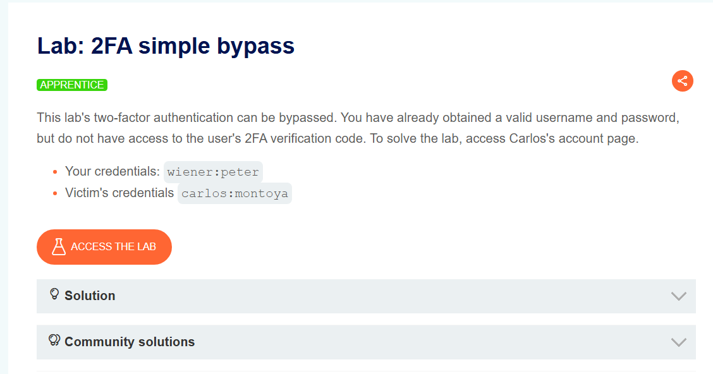
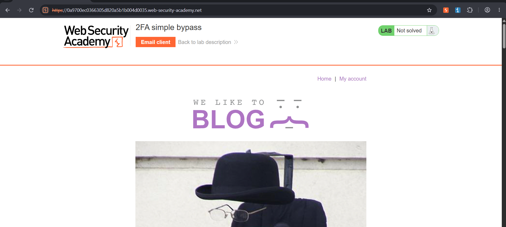
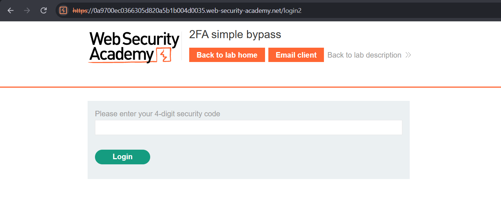
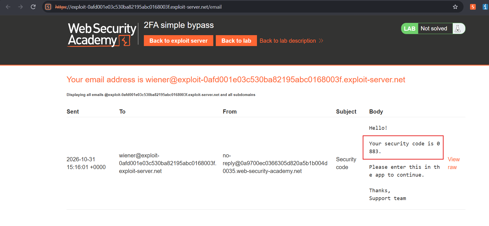
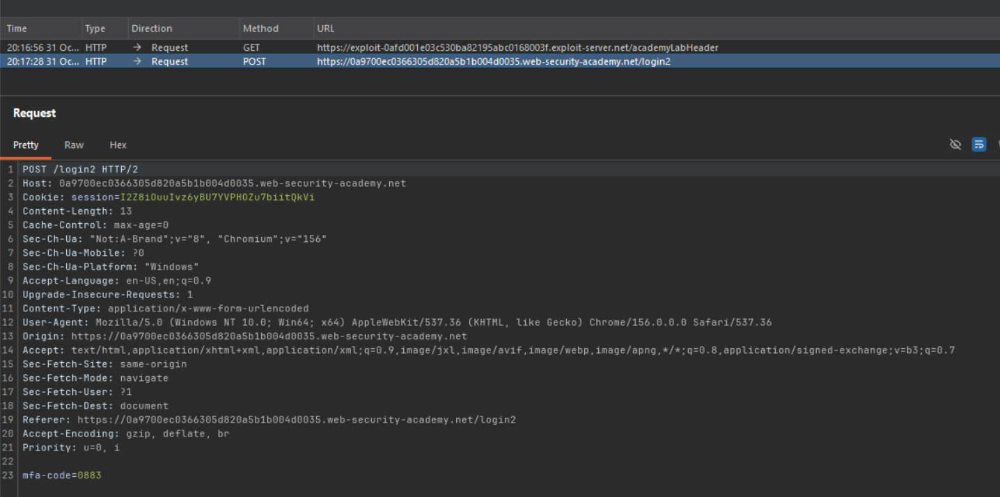
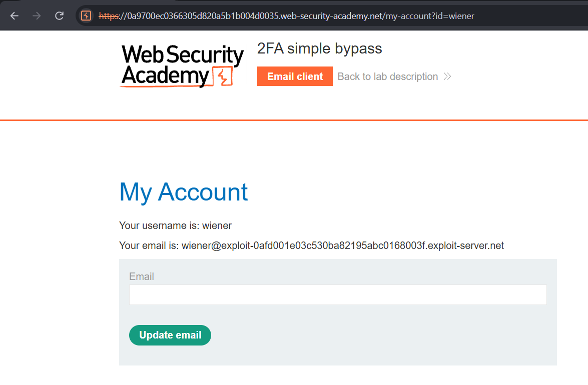
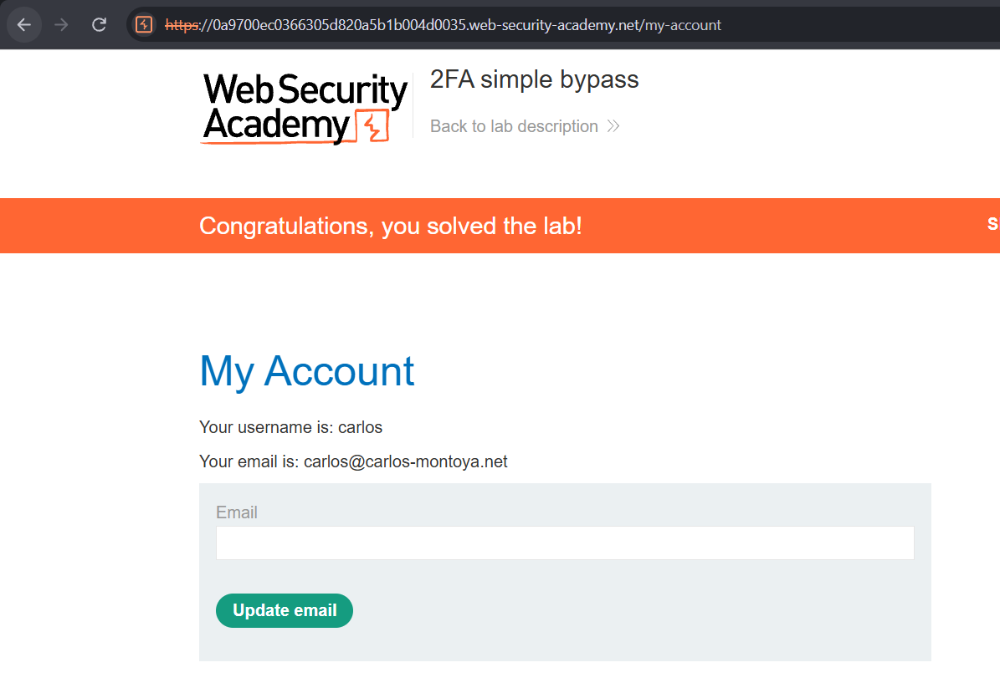

instance: `https://0a9700ec0366305d820a5b1b004d0035.web-security-academy.net/`

Given account: `wiener:peter`

Victim account: `carlos:montoya`

> ***The goal of this lab is to bypass 2FA and login as carlos user***

Open it in burpsuite proxy:

First, I will login as `wiener` user from `/login` endpoint. Username and password were accepted and app asked for a 2FA code:

The code was sent to email via email client:

OTP code is `0883`. After entering the code we can see our request was passed through `/login2` endpoint:

After login I was redirect to `my-account` endpoint for `wiener` user:

Next, I logged out and logged in using Carlos's credentials. As I dont have access to `carlos` email for OTP, I manually changed the URL to `my-account` after submitting credentials for `carlos` and got access to `carlos` account:

***Why did this work?***

Because, the account page was not properly protected. Application did not check if 2FA was completed. There was no proper server-side validation present.